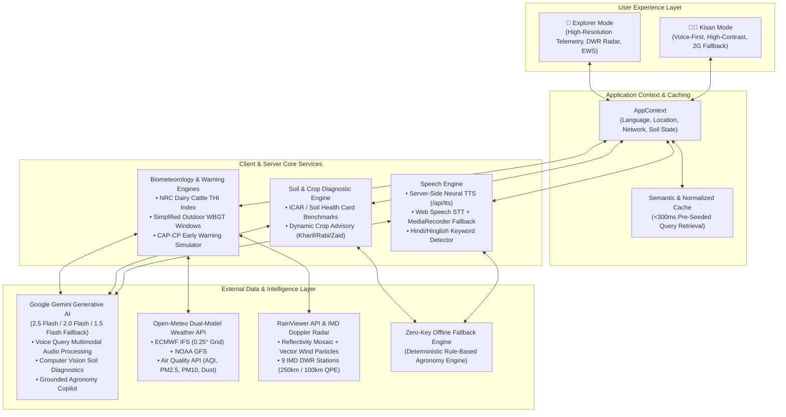

# Mausam Vaani (मौसम वाणी)

> **Hyperlocal Multimodal Weather & Agricultural Advisory Platform for Indian Agriculture**

[](https://nextjs.org/)
[](https://www.typescriptlang.org/)
[](https://tailwindcss.com/)
[](https://ai.google.dev/)
[](https://open-meteo.com/)
[](LICENSE)

Mausam Vaani is a dual-mode, bilingual (Hindi & English) climate intelligence and agrometeorology web platform. It is engineered for **smallholder Indian farmers** requiring hands-free, voice-first Devanagari guidance under low-bandwidth rural conditions, as well as **agronomists, researchers, and district administrators** needing high-resolution atmospheric telemetry, Doppler radar imagery, and early warning simulation.

---

## 📑 Table of Contents

- [Why This Exists](#why-this-exists)
- [System Architecture](#system-architecture)
- [Two Modes, Two Audiences](#two-modes-two-audiences)
  - [1. Kisan Mode (किसान मोड) - For Farmers](#1-kisan-mode-किसान-मोड---for-farmers)
  - [2. Explorer Mode (एक्सप्लोरर मोड) - For Agronomists & Officers](#2-explorer-mode-एक्सप्लोरर-मोड---for-agronomists--officers)
- [Tech Stack](#tech-stack)
- [Engineering Highlights & Problem Solving](#engineering-highlights--problem-solving)
- [Project Structure](#project-structure)
- [Getting Started](#getting-started)
  - [Prerequisites](#prerequisites)
  - [Installation](#installation)
  - [Environment Configuration](#environment-configuration)
  - [Running the App](#running-the-app)
- [Keywords & Domain Standards](#keywords--domain-standards)
- [Author & Acknowledgements](#author--acknowledgements)

---

## Why This Exists

Most modern weather applications are designed around English-literate users with fast 4G/5G mobile connections, displaying dense radar overlays and abstract metric cards. In contrast, smallholder farmers in rural India face three practical challenges:

1. **Linguistic & Literacy Barriers**: Critical agrometeorological decisions (whether to irrigate, spray pesticides, sow, or harvest) must be delivered in natural, spoken Hindi (or local dialects) in conversational tone.
2. **Network Degradation (2G / Low Connectivity)**: Mobile networks in remote agricultural fields frequently drop to 2G speeds or disconnect entirely, rendering heavy web bundles and high-frequency polling useless.
3. **Actionability Gap**: Farmers do not need raw barometric pressure in hectopascals; they need direct, timely agronomic directives (e.g., *"Postpone spray: 45 km/h gusts and 70% rain expected after 11:30 AM"*).

Mausam Vaani solves this with a **bilingual dual-mode architecture**: an accessible, large-touch-target, voice-driven interface for farmers (**Kisan Mode**), paired with a deep meteorological telemetry and early-warning operations center for officers and researchers (**Explorer Mode**).

---

## System Architecture



---

## Two Modes, Two Audiences

### 1. Kisan Mode (किसान मोड) - For Farmers

Designed according to Material Design 3 and rural accessibility heuristics: large touch targets, high contrast, iconography, and full Devanagari Hindi support.

| Feature | Capabilities & Engineering Specs |
|---|---|
| **वाक सहायक (Rural Voice Assistant)** | Hands-free speech input in Hindi or English. Automatically identifies dialectal keywords, transcodes audio via `MediaRecorder` when browser STT fails, feeds base64 audio directly to Gemini Multimodal, and speaks back via chunked neural audio. |
| **मेरी ज़मीन (My Land & Soil Health)** | Land parcel setup (area in acres/bighas, water source). Supports live camera capture / upload of soil photographs for ICAR Soil Health Card (SHC) evaluation (Vertisol/Black Cotton, Loamy, Red/Murrum, Alluvial) with estimated N-P-K benchmarks, pH, and organic carbon. |
| **फसल सलाह (Crop Advisory)** | Season-specific crop advice (Kharif, Rabi, Zaid) dynamically calculated from current soil moisture (0-1cm depth), 7-day rainfall forecasts, and soil drainage properties. |
| **मौसम चेतावनी (EWS Emergency Alerts)** | Color-coded alerts formatted according to Common Alerting Protocol (CAP-CP) standards (Red / Orange / Yellow / Green), accompanied by spoken audio alerts and step-by-step farmer action guides. |
| **2G / Low-Bandwidth Mode** | One-tap manual or auto-detected network mode that disables heavy map tiles, disables non-essential animations, and serves cached meteorological summaries. |

---

### 2. Explorer Mode (एक्सप्लोरर मोड) - For Agronomists & Officers

A specialized workspace designed for researchers, Krishi Vigyan Kendra (KVK) scientists, and district disaster management officers.

| Feature | Capabilities & Engineering Specs |
|---|---|
| **Multi-Model Consensus Telemetry** | Fetches parallel forecasts from **ECMWF IFS (0.25° grid)** and **NOAA GFS Seamless** via Open-Meteo. Automatically computes temperature delta ($\Delta T$) and precipitation probability alignment, rendering a deterministic ensemble consensus score (85%–99.4%). |
| **Interactive Doppler Weather Radar** | Leaflet-based interactive radar with live RainViewer precipitation reflectivity mosaics, nowcasting animation scrubber, wind particle vector fields, and 9 IMD Doppler Weather Radar (DWR) station overlays with 250km detection and 100km Quantitative Precipitation Estimation (QPE) rings. |
| **Early Warning Broadcast Simulator** | Interactive CAP alert dissemination simulator across Cell Broadcast, SMS, and IVR channels, targeting specific tehsils/blocks with synthesized official 853Hz / 960Hz dual-tone acoustic sirens. |
| **Automated Agromet Bulletin (GKMS)** | One-click generator for official Gramin Krishi Mausam Sewa (GKMS) district advisories with formatted tables for temperature, rainfall probabilities, irrigation windows, pest notices, and print-to-PDF layout. |
| **Livestock THI & Labor Safety (WBGT)** | Computes Temperature-Humidity Index (THI) for dairy cattle and buffaloes (NRC/Thom formula) to forecast milk yield loss and heat distress. Computes simplified Wet-Bulb Globe Temperature (WBGT) to prescribe hourly safe manual field labor windows. |
| **Monsoon Deficit Tracker** | Monitors cumulative seasonal rainfall against IMD Long Period Average (LPA) benchmarks, tracking departure percentages (Deficient, Normal, Excess). |
| **Journey Weather Corridor Planner** | Multi-point route weather calculator between source and destination districts across Indian agricultural corridors (e.g., Indore–Bhopal, Lucknow–Varanasi, Delhi–Jaipur), computing waypoint risks and logistics safety ratings. |
| **Climate AI Copilot** | Multi-turn conversational research copilot grounded in ICAR Package of Practices, Soil Health Card norms, and live telemetry, with session memory and multi-source verification. |

---

## Tech Stack

| Layer | Technologies | Purpose |
|---|---|---|
| **Framework** | Next.js 14.2 (App Router), React 18.3, TypeScript 5.9 | Full-stack server/client architecture, SSR streaming, strict type safety |
| **Styling & Design** | Tailwind CSS 3.4, Material Design 3 tokens, Lucide Icons, Material Symbols | High-contrast accessible design tokens, adaptive spacing, rural readability |
| **Generative AI** | `@google/generative-ai` SDK (Gemini 2.5 Flash, 2.0 Flash, 1.5 Flash) | Multimodal audio queries, computer vision soil diagnosis, grounded agronomic reasoning |
| **Audio & Speech** | Custom Server-Side Neural TTS (`/api/tts`), Web Speech API, Web Audio API | Low-latency Devanagari neural speech synthesis, 853/960Hz emergency siren generator |
| **Mapping & Geospatial**| Leaflet 1.9, React-Leaflet, OpenStreetMap, ESRI Satellite, OpenTopoMap | Client-side Doppler radar visualization, wind stream canvas, IMD radar radius rings |
| **Atmospheric Telemetry**| Open-Meteo Forecast & Air Quality API, RainViewer Radar API | Live ECMWF IFS, NOAA GFS, PM2.5, PM10, CO, NO2, Dust, and radar nowcast feeds |

---

## Engineering Highlights & Problem Solving

### 1. Resilient Multi-Tier Gemini Model Fallback
- **Problem**: Relying on a single AI model version causes service interruptions when API quotas are hit or when model versions deprecate.
- **Solution**: Implemented an automated sequential fallback pipeline in [`src/lib/geminiHelper.ts`](file:///C:/Projects/final%20run/Akash-Vaani/src/lib/geminiHelper.ts). The engine attempts models in priority order:
  $$\text{GEMINI\_MODEL (Env)} \longrightarrow \text{gemini-2.5-flash} \longrightarrow \text{gemini-2.0-flash} \longrightarrow \text{gemini-1.5-flash}$$
  If a model throws a 404, rate limit (429), or timeout, the request seamlessly cascades without client interruption.

### 2. High-Fidelity Neural TTS with Hindi Boundary Parsing
- **Problem**: Native browser `SpeechSynthesis` voices on mobile devices often produce robotic, illegible Hindi pronunciation and fail on Devanagari numerals.
- **Solution**: Developed a server-side neural TTS streaming route ([`src/app/api/tts/route.ts`](file:///C:/Projects/final%20run/Akash-Vaani/src/app/api/tts/route.ts)) that:
  - Intelligently splits sentences respecting both Hindi punctuation (danda `।`) and Western punctuation (`.`, `?`, `!`).
  - Fetches audio chunks in parallel (`Promise.all`) to minimize time-to-first-byte (TTFB).
  - Caches combined audio buffers in-memory with LRU eviction.
  - Supports HTTP 206 Partial Content Range requests for instant mobile playback.

### 3. Leaflet SSR and Webpack Icon Path Resolution
- **Problem**: Leaflet directly references `window` and `document` at import time, triggering Next.js App Router hydration crashes (`window is not defined`). Leaflet's marker icons also break when bundled by Webpack/Next.js.
- **Solution**: Isolated map rendering inside dynamic client mounts using `import('leaflet')` within `useEffect` hooks and manually re-mapped marker retina assets to unpkg CDN endpoints ([`src/components/explorer/InteractiveRadarMap.tsx`](file:///C:/Projects/final%20run/Akash-Vaani/src/components/explorer/InteractiveRadarMap.tsx)).

### 4. Zero-Key Offline Domain Fallback Engine
- **Problem**: In remote fields with zero internet or when API keys are not provided by developers testing the repository, the app must not crash.
- **Solution**: Built [`src/lib/apiFallbackHelper.ts`](file:///C:/Projects/final%20run/Akash-Vaani/src/lib/apiFallbackHelper.ts) and [`src/lib/cacheService.ts`](file:///C:/Projects/final%20run/Akash-Vaani/src/lib/cacheService.ts). A pre-seeded semantic normalized query cache satisfies top farmer questions in **<300ms**, and a deterministic ICAR-grounded rule engine produces valid crop advisories, soil diagnostics, and copilot responses without third-party network dependencies.

### 5. Multi-Model Atmospheric Consensus Engine
- **Problem**: Single weather models frequently exhibit spatial biases during convective monsoon storms across the Indian subcontinent.
- **Solution**: Programmed a deterministic consensus algorithm ([`src/lib/weatherService.ts`](file:///C:/Projects/final%20run/Akash-Vaani/src/lib/weatherService.ts)) comparing ECMWF IFS (0.25° European Center) against NOAA GFS (Global Forecast System) hourly runs. The engine calculates temperature divergence ($\Delta T$) and precipitation probability agreement to provide agronomists with an empirical confidence index.

---

## Project Structure

```text
Akash-Vaani/
├── public/                     # Static assets, icons, and manifests
├── src/
│   ├── app/
│   │   ├── api/
│   │   │   ├── copilot/        # Agronomy Copilot API (Gemini with fallback)
│   │   │   ├── diagnose-soil/  # Multimodal Soil Image Classification API
│   │   │   ├── reverse-geocode/# Reverse geocoding for Indian GPS coords
│   │   │   ├── tts/            # High-fidelity chunked server TTS route
│   │   │   └── voice-query/    # Multimodal audio transcription & advisory
│   │   ├── globals.css         # Tailwind utilities & MD3 design tokens
│   │   ├── layout.tsx          # Root layout with fonts & metadata
│   │   └── page.tsx            # Main dual-mode view controller
│   ├── components/
│   │   ├── Header.tsx          # Navigation, language & mode switchers
│   │   ├── MobileNavDrawer.tsx # Rural mobile navigation drawer
│   │   ├── NetworkBanner.tsx   # 2G / low-bandwidth mode alert bar
│   │   ├── Sidebar.tsx         # Explorer mode desktop sidebar
│   │   ├── explorer/           # Explorer Mode components
│   │   │   ├── AgrometBulletinModal.tsx      # GKMS IMD bulletin generator
│   │   │   ├── EarlyWarningSimulatorModal.tsx# CAP siren & broadcast simulator
│   │   │   ├── ExplorerAlertsCenter.tsx      # CAP-CP alert monitoring
│   │   │   ├── ExplorerClimateAI.tsx         # Researcher AI chat terminal
│   │   │   ├── ExplorerClimateAnalytics.tsx  # Precipitation anomalies & charts
│   │   │   ├── ExplorerJourneyPlanner.tsx    # Corridor route weather calculator
│   │   │   ├── ExplorerWeatherDashboard.tsx  # Multi-model telemetry cards
│   │   │   ├── ExplorerWorkSafety.tsx        # THI & WBGT biometeorology
│   │   │   ├── InteractiveRadarMap.tsx       # Leaflet radar & wind particle map
│   │   │   ├── LaborWorkWindows.tsx          # Safe field work hourly schedule
│   │   │   ├── LivestockThiCard.tsx          # Dairy cattle heat stress card
│   │   │   ├── MonsoonDeficitTracker.tsx     # Seasonal LPA rainfall tracker
│   │   │   └── WaypointWeatherTable.tsx      # Highway corridor waypoint table
│   │   └── kisan/              # Kisan Mode components
│   │       ├── KisanAlerts.tsx         # Color-coded audio-enabled alerts
│   │       ├── KisanCropAdvisory.tsx   # Dynamic seasonal crop guidance
│   │       ├── KisanHome.tsx           # Large touch-target home overview
│   │       ├── KisanLandSetup.tsx      # Soil photography & land parameters
│   │       └── KisanVoiceAssistant.tsx # Hands-free voice dialog interface
│   ├── context/
│   │   └── AppContext.tsx      # Global state (mode, language, telemetry, cache)
│   ├── lib/
│   │   ├── agrometBulletinGenerator.ts # HTML & print GKMS bulletin formatter
│   │   ├── aiCopilotService.ts         # Client wrapper for copilot queries
│   │   ├── alertService.ts             # CAP alert generation & THI formulas
│   │   ├── apiFallbackHelper.ts        # Zero-key offline agronomy engine
│   │   ├── cacheService.ts             # Normalized sub-300ms query cache
│   │   ├── cropAdvisorService.ts       # ICAR package of practices & crops
│   │   ├── geminiHelper.ts             # Model fallback & JSON sanitization
│   │   ├── indiaLocations.ts           # Pre-configured Indian districts & tehsils
│   │   ├── speechService.ts            # Client voice recognition & TTS handler
│   │   ├── translations.ts             # Full bilingual Devanagari dictionary
│   │   └── weatherService.ts           # Open-Meteo & multi-model consensus
│   └── types/
│       └── index.ts            # Comprehensive TypeScript type definitions
├── .env.example                # Sample environment variables
├── package.json
├── tailwind.config.js          # Material Design 3 theme extensions
└── tsconfig.json
```

---

## Getting Started

### Prerequisites

- **Node.js**: 18.17.0 or higher
- **npm** (v9+) or **yarn**

### Installation

1. Clone the repository:
   ```bash
   git clone https://github.com/your-username/mausam-vaani.git
   cd mausam-vaani
   ```

2. Install dependencies:
   ```bash
   npm install
   ```

### Environment Configuration

Create a `.env.local` file in the project root:

```bash
cp .env.example .env.local
```

Populate the configuration keys:

```env
# Google Gemini API Key (Required for live AI features; intelligent offline fallback activates if omitted)
GEMINI_API_KEY=your_gemini_api_key_here

# Optional: Override the primary Gemini model (default: gemini-2.5-flash)
# GEMINI_MODEL=gemini-2.5-flash

# Optional: OpenWeatherMap API Key (Open-Meteo multi-model API is used by default with zero keys required)
# OPENWEATHER_API_KEY=your_openweathermap_api_key_here
```

> [!NOTE]
> **Zero-Config Ready**: If `GEMINI_API_KEY` is left blank, the application will automatically activate its internal ICAR-grounded heuristic and caching engine, allowing full local UI testing without external API credentials.

### Running the App

Start the development server:

```bash
npm run dev
```

Open [http://localhost:3000](http://localhost:3000) in your browser.

- To open **Kisan Mode** directly: [http://localhost:3000?mode=kisan](http://localhost:3000?mode=kisan)
- To open **Explorer Mode** directly: [http://localhost:3000?mode=explorer](http://localhost:3000?mode=explorer)

Production build and execution:

```bash
npm run build
npm run start
```

---

## Keywords & Domain Standards

- **Agrometeorology**: Gramin Krishi Mausam Sewa (GKMS), Agromet Advisory Bulletins (AAS), Crop Phenology.
- **Early Warning Systems (EWS)**: ITU / NDMA Common Alerting Protocol (CAP-CP v1.2), Cell Broadcast emergency siren simulation.
- **Multimodal AI**: Direct audio transcription, computer vision for Soil Health Card (SHC) taxonomy, ICAR Package of Practices.
- **Biometeorology**: Dairy cattle Temperature-Humidity Index (THI - NRC formulation), simplified Wet-Bulb Globe Temperature (WBGT) occupational safety.
- **Meteorological Ensembles**: ECMWF IFS (0.25° grid), NOAA GFS, Doppler Weather Radar (DWR) reflectivity mosaics, Quantitative Precipitation Estimation (QPE).
- **Rural Web Engineering**: Material Design 3 high-contrast tokens, Web Audio API synthesis, 2G bandwidth degradation mode, client-side normalized query caching.


