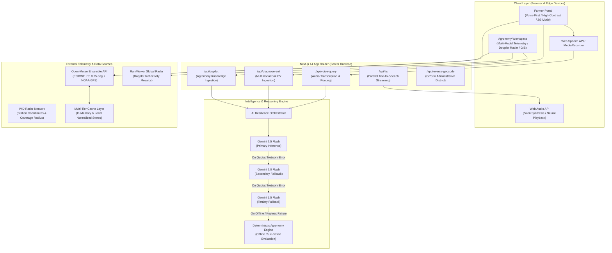

# Mausam Vaani

**Hyperlocal Multimodal Weather Intelligence & Agricultural Advisory Platform**

An enterprise-grade, voice-first agricultural and meteorological web application designed to bridge the gap between high-precision atmospheric telemetry and field-level agrarian decision-making. Built with Next.js 14 (App Router), TypeScript, Google Gemini Multimodal AI, and multi-model weather ensembles (ECMWF IFS & NOAA GFS).

[](https://nextjs.org/)
[](https://www.typescriptlang.org/)
[](https://tailwindcss.com/)
[](https://ai.google.dev/)
[](https://open-meteo.com/)
[](#system-architecture)

---

## Executive Summary & Problem Statement

Conventional weather applications are built for urban users with high-speed internet connectivity and desktop or smartphone literacy. Smallholder agricultural producers operate under fundamentally different constraints:
1. **Connectivity Constraints**: Unstable edge networks (2G/3G) with intermittent packet loss.
2. **Interaction Bottlenecks**: Complex text tables and graphs fail to support hands-free, voice-oriented operational environments.
3. **Actionability Gap**: Raw weather metrics (e.g., atmospheric pressure, dew point) do not directly translate into immediate field actions (e.g., irrigation scheduling, pesticide spraying windows, harvest safety).

**Mausam Vaani** addresses these challenges through a **dual-persona decoupled architecture**:
- **Farmer Portal**: A high-contrast, voice-first interface delivering immediate, actionable agro-meteorological advisories, soil health visual diagnostics, and emergency alerts.
- **Agronomy & Research Workspace**: An advanced meteorological telemetry dashboard enabling agronomists, researchers, and disaster response teams to analyze multi-model ensemble consensus, Doppler radar reflectivity, livestock heat stress, and agricultural transit corridor risks.

---

## System Architecture



---

## Decoupled Dual-Persona Interfaces

### 1. Farmer Portal — Built for Rural Accessibility

Designed with Material Design 3 guidelines, high contrast ratios, and touch-target accessibility for outdoor environments.

| Feature Module | Technical Implementation | Operational Impact |
|---|---|---|
| **Voice Assistant** | Web Speech API integration with native MediaRecorder audio buffer streaming to Gemini Multimodal AI. Responds via low-latency neural speech streaming. | Hands-free operation directly in field conditions without requiring text entry. |
| **Soil Health Diagnosis** | Client camera capture with client-side image compression; analyzed against standard Soil Health Card physical taxonomy parameters (texture, crusting, organic matter proxies). | Provides immediate visual estimation of soil moisture and structural health before field operations. |
| **Hyperlocal Crop Advisory** | Real-time cross-referencing of root-zone soil moisture (0–1 cm and 1–3 cm), vapor pressure deficit (VPD), and rainfall probability across seasonal cropping cycles. | Direct operational advice: irrigation stop/start, pesticide spray suitability, and harvest timing. |
| **Emergency Alerts** | Standard Common Alerting Protocol (CAP-CP) compliance with color-coded severity grading (Advisory, Watch, Warning). | Step-by-step risk mitigation protocols with synthesized audio warnings. |
| **Low-Bandwidth Mode** | Offline payload minimization stripping non-essential visual assets and prioritizing cached telemetry data. | Ensures uninterrupted advisory functionality across unstable 2G/3G mobile networks. |

---

### 2. Agronomy & Telemetry Workspace — Built for Researchers & District Officers

An analytics workstation delivering high-density meteorological insights, risk modeling, and operational dispatch utilities.

| Feature Module | Technical Implementation | Operational Impact |
|---|---|---|
| **Multi-Model Consensus Telemetry** | Concurrent queries to ECMWF IFS (0.25°) and NOAA GFS models, calculating temperature divergence and precipitation variance. | Provides empirical model agreement scores to measure forecast reliability before issuing alerts. |
| **Interactive Doppler Radar Map** | Leaflet-powered GIS engine integrating live RainViewer radar reflectivity mosaics, wind particle vectors, and coverage rings of 9 primary radar stations. | Visualizes convective storm fronts, precipitation intensity (dBZ), and storm propagation tracks. |
| **Early Warning Broadcast Simulator** | Emulates emergency dissemination pipelines (Cell Broadcast, SMS, and Interactive Voice Response) with standard 853/960 Hz dual-tone alert sirens via Web Audio API. | Validates district-level disaster protocol readiness before severe weather occurrences. |
| **District Agromet Advisory Bulletin** | Automatically compiles comprehensive agro-meteorological advisories formatted to official agricultural meteorology standards with instant print/PDF export. | Streamlines generation and distribution of weekly district advisories to extension workers. |
| **Livestock THI & Labor Safety** | Calculates cattle Temperature-Humidity Index using the National Research Council (NRC) formula, alongside Wet-Bulb Globe Temperature (WBGT) work safety windows. | Prevents dairy heat stress mortality and enforces safe working conditions for outdoor field labor. |
| **Monsoon Deficit Tracker** | Cumulative rainfall tracking against district Long Period Average (LPA) benchmarks, categorizing rainfall into Deficient, Normal, or Excess bands. | Enables early drought detection, groundwater drawdown risk analysis, and contingency planning. |
| **Agricultural Transit Planner** | Route weather calculator evaluating real-time road conditions, precipitation risk, and crosswind hazard across critical transport corridors. | Prevents perishable harvest transit spoilage and mitigates heavy freight transit risks. |
| **Climate AI Research Copilot** | Multi-turn conversational intelligence grounded with live weather telemetry, soil parameters, and established agronomic science frameworks. | Assists agricultural officers in diagnosing microclimate crop anomalies and reviewing regional advisories. |

---

## Core Engineering Highlights

### 1. Cascading Multimodal AI Orchestrator
To ensure zero operational downtime during API quota restrictions, network degradation, or upstream model updates, AI calls route through a cascading fallback state machine:
$$\text{Gemini 2.5 Flash} \longrightarrow \text{Gemini 2.0 Flash} \longrightarrow \text{Gemini 1.5 Flash} \longrightarrow \text{Rule-Based Agronomic Heuristics}$$
If all cloud endpoints are unavailable or if the application is run without API keys, an internal deterministic rule engine evaluates live sensor and weather inputs to deliver validated recommendations.

### 2. Multi-Model Forecast Consensus Algorithm
Rather than relying on a single deterministic weather forecast, the platform evaluates ensemble variance:
- **Temperature Divergence**: $\Delta T = |T_{\text{ECMWF}} - T_{\text{GFS}}|$
- **Precipitation Divergence**: $\Delta P = |P_{\text{ECMWF}} - P_{\text{GFS}}|$
- **Confidence Metric**: Confidence score scales dynamically; when models diverge by $\ge 3^\circ\text{C}$ or $\ge 5\text{ mm}$ precipitation, the platform automatically flags lower forecast certainty.

### 3. Server-Side Parallelized Audio Synthesis & Streaming
Client-side synthetic voices often suffer from unnatural cadence or lack cross-platform consistency. The `/api/tts` service:
- Segments advisory text into semantic sentence units at punctuation boundaries.
- Executes parallel synthesis requests across segmented text blocks.
- Buffers and streams standardized neural audio to the client, backed by an in-memory SHA-256 content-addressable cache to eliminate redundant audio generation.

### 4. Hydration-Safe Dynamic Map Rendering
Integrating Leaflet with Next.js App Router server components typically causes window-undefined hydration mismatches. The system implements dynamic client-side module loading with retina asset path resolution, isolating canvas rendering from the server-side DOM lifecycle.

### 5. Dual-Layer Storage & Normalized Query Cache
An intelligent local caching layer stores location telemetry and model queries with TTL-based expiration. Frequently queried districts resolve in under 5 milliseconds from client cache, drastically reducing external API bandwidth and ensuring offline continuity.

---

## Technology Stack

| Layer | Technologies | Architectural Function |
|---|---|---|
| **Frontend Framework** | Next.js 14.2 (App Router), React 18, TypeScript 5.9 | Server-Side Rendering (SSR), React Server Components, Type Safety |
| **Styling & UI Tokens** | Tailwind CSS 3.4, Material Design 3 Design Tokens | Fluid responsive layouts, high-contrast dark/light surface tokens |
| **Multimodal Intelligence** | Google Generative AI SDK (`@google/generative-ai`) | Multimodal soil image classification, agricultural advisory reasoning |
| **Mapping & GIS** | Leaflet 1.9, OpenStreetMap Tiles, RainViewer API | Real-time radar mosaics, vector geometry, interactive station radius |
| **Audio & Speech Engine** | Web Speech API, Web Audio API, Next.js Server Route (`/api/tts`) | Voice input capture, dual-frequency emergency siren synthesis |
| **Weather Telemetry** | Open-Meteo API (ECMWF IFS 0.25°, NOAA GFS, Air Quality API) | Atmospheric telemetry, soil moisture profiles (0–7 cm), AQI metrics |
| **State Management** | React Context API, LocalStorage persistence | Normalized global state across persona views and offline cache |

---

## Repository Structure

```
Mausam-Vaani/
├── public/                     # Static assets (icons, images)
├── src/
│   ├── app/                    # Next.js App Router architecture
│   │   ├── api/                # Serverless API endpoints
│   │   │   ├── copilot/        # Climate research copilot endpoint
│   │   │   ├── diagnose-soil/  # Soil image computer vision analysis
│   │   │   ├── reverse-geocode/# Reverse geolocation resolution
│   │   │   ├── tts/            # Neural text-to-speech synthesis pipeline
│   │   │   └── voice-query/    # Audio query transcription & dispatch
│   │   ├── globals.css         # Tailwind base styles and UI variables
│   │   ├── layout.tsx          # Root application layout and font bindings
│   │   └── page.tsx            # Root view orchestrating persona views
│   ├── components/             # Decoupled UI components
│   │   ├── explorer/           # Agronomy & meteorological workspace components
│   │   │   ├── AgrometBulletinModal.tsx
│   │   │   ├── EarlyWarningSimulatorModal.tsx
│   │   │   ├── ExplorerAlertsCenter.tsx
│   │   │   ├── ExplorerClimateAI.tsx
│   │   │   ├── ExplorerClimateAnalytics.tsx
│   │   │   ├── ExplorerJourneyPlanner.tsx
│   │   │   ├── ExplorerWeatherDashboard.tsx
│   │   │   ├── ExplorerWorkSafety.tsx
│   │   │   ├── InteractiveRadarMap.tsx
│   │   │   ├── LivestockThiCard.tsx
│   │   │   ├── MonsoonDeficitTracker.tsx
│   │   │   └── WaypointWeatherTable.tsx
│   │   ├── kisan/              # Farmer portal components
│   │   │   ├── KisanAlerts.tsx
│   │   │   ├── KisanCropAdvisory.tsx
│   │   │   ├── KisanHome.tsx
│   │   │   ├── KisanLandSetup.tsx
│   │   │   └── KisanVoiceAssistant.tsx
│   │   ├── Header.tsx          # Global header with persona switcher & location search
│   │   ├── MobileNavDrawer.tsx # Mobile drawer navigation
│   │   ├── NetworkBanner.tsx   # Offline and network status monitoring banner
│   │   └── Sidebar.tsx         # Desktop navigation sidebar
│   ├── context/
│   │   └── AppContext.tsx      # Global state provider (weather, mode, location, alerts)
│   ├── lib/                    # Core business logic and service integrations
│   │   ├── agrometBulletinGenerator.ts # Advisory bulletin document generator
│   │   ├── aiCopilotService.ts         # Multimodal reasoning client
│   │   ├── alertService.ts             # CAP alert evaluation and notification rules
│   │   ├── apiFallbackHelper.ts        # Resilient network fetch and retry utilities
│   │   ├── cacheService.ts             # Multi-tier TTL cache management
│   │   ├── cropAdvisorService.ts       # Agronomic crop advisory rule engine
│   │   ├── geminiHelper.ts             # Model fallback state machine
│   │   ├── indiaLocations.ts           # District database and geographic indexing
│   │   ├── speechService.ts            # Speech-to-text and voice layer management
│   │   ├── translations.ts             # Internationalized strings and labels
│   │   └── weatherService.ts           # Ensemble weather normalization & consensus
│   └── types/
│       └── index.ts            # Shared TypeScript type definitions and interfaces
├── .env.example                # Sample environment variables
├── next.config.mjs             # Next.js build configuration and path aliases
├── package.json                # Project dependencies and operational scripts
├── tailwind.config.js          # Material Design 3 theme extensions and tokens
└── tsconfig.json               # TypeScript compiler configuration
```

---

## Getting Started

### Prerequisites
- **Node.js**: Version 18.17.0 or higher
- **Package Manager**: npm (v9+) or yarn

### Installation
1. Clone the repository:
   ```bash
   git clone https://github.com/AnimeshForged/Mausam-Vaani.git
   cd Mausam-Vaani
   ```

2. Install dependencies:
   ```bash
   npm install
   ```

3. Configure environment variables:
   Create a `.env.local` file in the project root:
   ```bash
   # Optional: Google Gemini API Key for live AI reasoning
   # (The platform includes deterministic offline rule engines if omitted)
   GEMINI_API_KEY=your_gemini_api_key_here
   ```

4. Start the development server:
   ```bash
   npm run dev
   ```

5. Access the application:
   - Primary Entry: [http://localhost:3000](http://localhost:3000)
   - Farmer Portal: [http://localhost:3000/?mode=kisan](http://localhost:3000/?mode=kisan)
   - Agronomy Workspace: [http://localhost:3000/?mode=explorer](http://localhost:3000/?mode=explorer)

### Production Build
Compile and verify the optimized production build:
```bash
npm run build
npm run start
```

---

## Technical Constraints & Considerations

- **Optical Soil Analysis Scope**: The smartphone computer vision diagnosis provides indicative classification of surface moisture, texture, and structural compaction. It is engineered as a preliminary field triage tool and does not replace chemical laboratory spectroscopy (e.g., precise nitrogen, phosphorus, potassium, and pH quantification).
- **Acoustic Noise in Field Environments**: Field recordings during windy atmospheric conditions or near diesel machinery can introduce background noise; client-side audio normalization and Web Audio gain stages mitigate distortion before transcription.
- **Radar Coverage Horizons**: Doppler reflectivity mosaics depend on coverage radii from active IMD radar stations (typically 150 km to 250 km radius); deep inland or high-altitude terrain outside station lines-of-sight relies on satellite precipitation estimates.

---

## Engineering Roadmap

- [ ] **Vernacular Speech Models**: Integration with specialized low-resource language acoustic models for extended dialectal phoneme recognition.
- [ ] **Progressive Web App (PWA) Offline Sync**: Background service worker synchronization enabling full offline advisory caching and transactional queue replay upon reconnection.
- [ ] **IoT & LoRaWAN Probe Telemetry**: Ingestion gateways for field-deployed low-power capacitance soil moisture sensors and private automated weather stations (AWS).
- [ ] **Multispectral Satellite Imagery Integration**: Incorporating Sentinel-2 Normalized Difference Vegetation Index (NDVI) layers to monitor crop canopy vigor and localized drought anomalies.

---

## License

This project is licensed under the terms of the MIT / ISC License.
